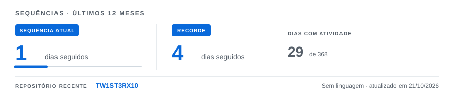



# TW1ST3RX10

### Walace Alves

**Information Systems Student**

 ·  · 

---

## 01 / ABOUT

Information Systems student focused on **software development, automation, and data governance.** I combine fundamental programming logic with **AI-assisted engineering** to build scalable workflows, real-time sync systems, and web platforms.
I use academic projects, experiments and personal ideas to turn what I learn into something concrete.

---

## 02 / CURRENTLY

Studying Information Systems

**Building:** Automated ETL pipelines, data governance tools, and workflow systems using JavaScript & Apps Script.

**Exploring:** Process automation, Flutter, project management, AI-assisted productivity and security.

Learning by building.

---

---

## 03 / ACTIVITY

---

## 04 / PROJECTS

### ACADEMIC

**SmartLib**

A platform focused on **book exchange, lending and social interaction**, developed as an academic project.

 ·  ·  · 

**ImunoPet**

<<<<<<< HEAD
Imuno Pet Brasil is an animal vaccination management system featuring **integration, metrics, and critical decision-making support**, developed as an academic project.
=======
Imuno Pet Brasil is an animal vaccination management system **featuring integration, metrics, and critical decision-making support**, developed as an academic project.
>>>>>>> ba67a247c37b71a4bf40d357d3341f0b791ca95e

 ·  ·  · 

---

### INSTITUTIONAL / PROCESS AUTOMATION

**EduData ETL & Access Governance**

Centralized data governance, ETL, and permission system developed via Google Apps Script. **Features real-time bidirectional synchronization, Regex sanitization, and dynamic access control (ACL) for 40+ operational units**.

 ·  ·  · 

**Student Internship Management & Status Portal**

Responsive web portal and automation engine for internship requests and tracking. Features a SPA interface, asynchronous internal API, real-time communication, unique protocol generation, and event-driven email notifications.

 ·  ·  ·  . 
---

## 05 / LAB

### IDEAS · EXPERIMENTS · PROTOTYPES

Not everything starts as a finished project.

This is where I explore technologies, test ideas and learn by building.

---

## 06 / STACK

### LANGUAGES

 ·  ·  ·  .  .  . 

### BACKEND & AUTOMATION

 ·  ·  .  .  .  . 

### DATABASE

### TOOLS & PRACTICES

 ·  ·  .  .  . 

---

## 07 / CONTACT

LinkedIn · Email

 

`TW1ST3RX10` · Walace Alves

