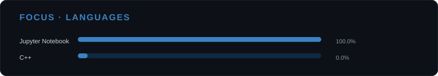



# TW1ST3RX10

### Walace Alves

**Information Systems Student**

`Software` · `Security` · `Research`

---

## 01 / ABOUT

Information Systems student interested in **software development, security and research**.

I use academic projects, experiments and personal ideas to turn what I learn into something concrete.

---

## 02 / CURRENTLY

> → Studying Information Systems  
> → Developing **Biblioteca Fácil**  
> → Exploring **Flutter**  
> → Deepening my knowledge of **Security**  
> → Building projects to learn by doing

---

---

## 03 / CONTRIBUTIONS

---

## 04 / PROJECTS

### ACADEMIC

#### Biblioteca Fácil

A platform focused on **book exchange, lending and social interaction**, developed as an academic project.

`NestJS` · `Prisma` · `MySQL` · `Flutter`

---

## 05 / LAB

**Ideas · Experiments · Prototypes**

A space for things that are not finished yet.

Projects, studies and experiments can start here before becoming something bigger.

---

## 06 / STACK

---

## 07 / CONTACT

LinkedIn · Email

 

`TW1ST3RX10` · Walace Alves

